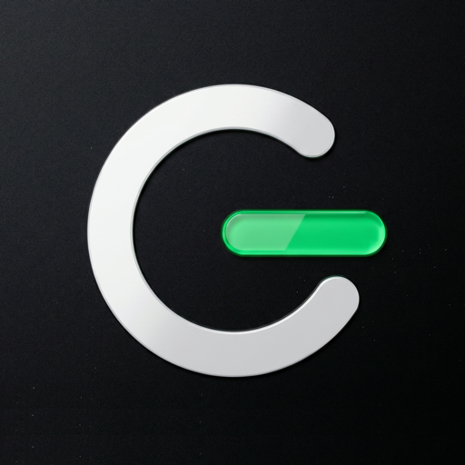

# GilmOS for Claude

Start a studio workspace or develop films in your existing [GilmOS](https://app.gilm.ai) projects from Claude. Write structured screenplays, break scenes into shots, prepare character and location references, generate images and videos, and save montage edit decisions. Read project and workspace chats and send authorized messages or replies as your connected account, plan resource delivery dates, project deadlines, tasks and meetings in the native GilmOS agenda.

## What's included

| Skill | Use it to |
| --- | --- |
| `gilmos-onboarding` | Understand workspaces and projects, inspect account setup, create a requested first FREE workspace and project |
| `gilmos-projects` | Connect, find a project, read its production context, manage documents, tasks, statuses and assignments |
| `gilmos-screenwriting` | Write or revise a screenplay with typed cinematic paragraphs, or run Alfred's long-screenplay and formatting workflows |
| `gilmos-storyboards` | Prepare scene breakdowns, shot lists and storyboard boards with narrative and visual continuity |
| `gilmos-assets` | Prepare characters, locations and props, select reference versions, run asset image and description workflows |
| `gilmos-generation` | Generate or display sandbox images and videos with exact asset tags and follow asynchronous jobs |
| `gilmos-montage` | Read and edit the saved montage timeline with revision checks |
| `gilmos-collaboration` | Read and send project/workspace chat messages and plan production in the agenda |

The plugin also declares one remote MCP server, `gilmos`, at `https://app.gilm.ai/mcp`, which provides the `gilmos_*` tools the skills use.

## Setup

### Connect without a marketplace listing

In Claude, open **Customize → Connectors → Add custom connector**, name it **GilmOS** and enter `https://app.gilm.ai/mcp`. Complete the OAuth sign-in and consent in your own GilmOS account. If Claude asks how to register its OAuth client, use **Register automatically**. Organization accounts may require an owner to add the connector first. This connects the tools without installing the plugin's skills or waiting for an official directory listing. See [Claude's custom connector instructions](https://support.claude.com/en/articles/11175166-get-started-with-custom-connectors-using-remote-mcp).

### Add the workflow skills

1. In Claude's **Customize → Plugins → Add plugin → Add marketplace**, add `genario-ai/gilmos-claude-plugin`, then add the `gilmos` plugin. In Claude Code, run `claude plugin marketplace add genario-ai/gilmos-claude-plugin` followed by `claude plugin install gilmos@gilmos-marketplace`.
   You can also upload an archive of this plugin in **Customize → Plugins → Add plugin → Upload plugin**.
2. Connect your GilmOS account through the OAuth sign-in window. In Claude Code, run `/mcp` and select `gilmos` if the connection has not opened automatically.
3. Ask, for example: "Help me set up my first GilmOS workspace" or "List my GilmOS projects and summarize the selected project's next production step."

You need a GilmOS account. Installing the plugin does not itself create a workspace or project. The plugin only reaches projects and conversations your account can already access.

This repository is an independent GitHub marketplace, not an Anthropic-approved listing. As of November 16, 2026, the publisher reports that official acceptance is still pending; this package does not establish the review outcome or its reason. Anthropic's [Software Directory Policy](https://support.claude.com/en/articles/13145358-anthropic-software-directory-policy) currently excludes standalone AI image, video and audio generation, with a limited exception for design-only image workflows. The full GilmOS generation offering therefore faces an eligibility restriction; installing it independently does not imply official approval.

## Media: viewing, references and uploads

Claude and GPT use the same GilmOS MCP server and tools. The plugin packages and the hosts' file/display capabilities differ. `gilmos_import_media` imports existing images, videos and audio into the global project Sandbox without generation or generation credits. Prefer `gilmos_create_upload_url` to reserve a private, write-only URL valid for 2 hours, send the original bytes by raw HTTP PUT (100 MiB max), then finalize with `gilmos_import_media` and `source:{kind:"upload",uploadId}` using the returned `requestId` and same name. Never send your GilmOS bearer token to storage or transcribe large base64 through the model. Temporary uploads are cleaned after expiry. Direct HTTPS URLs (100 MiB) and programmatically supplied base64 (30 MiB decoded) remain available. A conversation attachment or local path does not automatically supply those bytes to the remote connector.

| Need | Supported path |
| --- | --- |
| Inspect an existing GilmOS image | `gilmos_get_media` returns an image preview and a temporary original link; display depends on the Claude client |
| Retrieve a GilmOS video or audio | `gilmos_get_media` returns a temporary original link; inline playback depends on the Claude client |
| Import a public image as an asset reference | `gilmos_import_asset_references` accepts up to 40 `{assetId,imageUrl}` entries in `payload.references`; inspect imported versions and failures |
| Privately upload original files without putting bytes in model arguments | `gilmos_create_upload_url`, raw HTTP PUT using the returned method/headers, then `gilmos_import_media` with `source:{kind:"upload",uploadId}`; 100 MiB per file |
| Import an existing image, video or audio | `gilmos_import_media` with `source:{kind:"url",url:"https://…"}`; direct file URL, including an authorized temporary signed URL accessible without browser cookies |
| Import file bytes available to the host | `gilmos_import_media` with `source:{kind:"base64",data:"…"}`; actual standard base64, no `data:` prefix, up to 30 MiB decoded |
| Use a local file or Claude attachment unavailable to the host's tools | Upload the original in GilmOS first, then read its saved item/version ID through MCP |
| Use a stored reference for generation | Pass accessible `itemIds` or `assetVersions`, and exact asset tags; `gilmos_generate_media` does not accept external URLs |

For `gilmos_import_media`, supply `projectId`, `name` and a fresh UUID `requestId`. Reuse that UUID and identical arguments on retry. Optional `sha256` verifies the bytes. The result confirms the saved `itemId`, detected type/MIME, size and checksum; inspect it with `gilmos_get_media`, and use that ID in `itemIds` for later generation. Accepted formats: JPEG, PNG, WebP, GIF, AVIF, MP4, MOV, WebM, MP3, WAV, OGG (Vorbis/Opus), FLAC, M4A and AAC. Project editor permission is required. This tool saves Sandbox items, not asset/shot versions.

For public-image-to-asset import, provide a direct image URL reachable by the GilmOS server without browser cookies. A web page, `file://` path, Claude attachment identifier or Claude sandbox path is not such a URL. This separate import creates asset versions. Do not make a private file public or invent base64/URLs. After an import or manual upload, verify the saved record and use `gilmos_get_media` to inspect it; do not infer a successful transfer from a displayed attachment.

These are separate boundaries: the [MCP tool-result specification](https://modelcontextprotocol.io/specification/2025-06-18/server/tools) supports images and resource links, while Anthropic's directory policy restricts querying or extracting Claude user-uploaded files. Neither is evidence that MCP universally forbids media.

## Data and network behavior

- **Destinations**: MCP calls go to `https://app.gilm.ai/mcp`, operated by Gilm Technologies. Direct binary uploads use the returned signed URL on GilmOS Storage (`https://base.gilm.ai/storage/v1/`); this grants a temporary write to one private staging object, without sending the account bearer token. The plugin bundles no local code, scripts or hooks.
- **Authentication**: OAuth through the GilmOS identity provider (Supabase Auth). Tokens are stored by the Claude client; the plugin contains no credentials.
- **Permissions**: every tool acts with the connected user's GilmOS permissions, including private conversations the user is a member of.
- **Writes**: on request, tools can create a workspace or project, or create and update screenplays, scenes, shots, assets, montage documents, tasks, calendar events and chat messages in GilmOS. Messages are sent as your account and labelled "via MCP". Selected participants may receive GilmOS invitations and notifications.
- **Credits**: image/video generations and Alfred writing workflows consume your existing GilmOS credits. Creating a workspace or project does not supply generation credits.
- **Limits**: montage tools save edit decisions; rendering or exporting a finished video is not available through this plugin.

## Support and policies

- Help: <https://app.gilm.ai/help>
- Privacy policy: <https://app.gilm.ai/privacy>
- Terms of service: <https://app.gilm.ai/terms>
