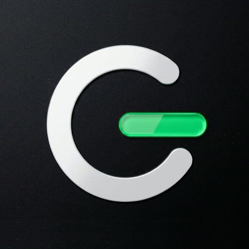

# gilmOS for Claude

Create and develop films in your existing [gilmOS](https://app.gilm.ai) projects from Claude. Write structured screenplays, break scenes into shots, prepare character and location references, generate images and videos, and save montage edit decisions. Read project and workspace chats and send authorized messages or replies as your connected account, plan resource delivery dates, project deadlines, tasks and meetings in the native gilmOS agenda.

## What's included

| Skill | Use it to |
| --- | --- |
| `gilmos-projects` | Connect, find a project, read its production context, manage documents, tasks, statuses and assignments |
| `gilmos-screenwriting` | Write or revise a screenplay with typed cinematic paragraphs, or run Alfred's long-screenplay and formatting workflows |
| `gilmos-storyboards` | Prepare scene breakdowns, shot lists and storyboard boards with narrative and visual continuity |
| `gilmos-assets` | Prepare characters, locations and props, select reference versions, run asset image and description workflows |
| `gilmos-generation` | Generate or display sandbox images and videos with exact asset tags and follow asynchronous jobs |
| `gilmos-montage` | Read and edit the saved montage timeline with revision checks |
| `gilmos-collaboration` | Read and send project/workspace chat messages and plan production in the agenda |

The plugin also declares one remote MCP server, `gilmos`, at `https://app.gilm.ai/mcp`, which provides the `gilmos_*` tools the skills use.

## Setup

1. Install the plugin.
2. When Claude first uses a gilmOS tool, connect your gilmOS account through the OAuth sign-in window. In Claude Code you can also run `/mcp` and select `gilmos`.
3. Ask, for example: "List my gilmOS projects and summarize the selected project's next production step."

You need a gilmOS account. The plugin only reaches projects and conversations your account can already access.

## Data and network behavior

- **Single destination**: all tool calls go to the gilmOS MCP server at `https://app.gilm.ai/mcp`, operated by Gilm Technologies. The plugin bundles no local code, scripts or hooks.
- **Authentication**: OAuth 2.1 through the gilmOS identity provider (Supabase Auth). Tokens are stored by the Claude client; the plugin contains no credentials.
- **Permissions**: every tool acts with the connected user's gilmOS permissions, including private conversations the user is a member of.
- **Writes**: tools can create or update screenplays, scenes, shots, assets, montage documents, tasks, calendar events and chat messages in gilmOS when you ask for it. Messages are sent as your account and labelled "via MCP". Selected participants may receive gilmOS invitations and notifications.
- **Credits**: image/video generations and Alfred writing workflows consume your existing gilmOS credits.
- **Limits**: montage tools save edit decisions; rendering or exporting a finished video is not available through this plugin.

## Support and policies

- Help: <https://app.gilm.ai/help>
- Privacy policy: <https://app.gilm.ai/privacy>
- Terms of service: <https://app.gilm.ai/terms>
